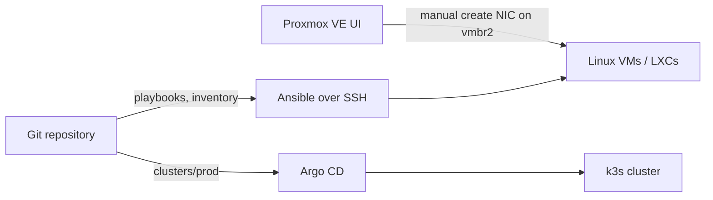
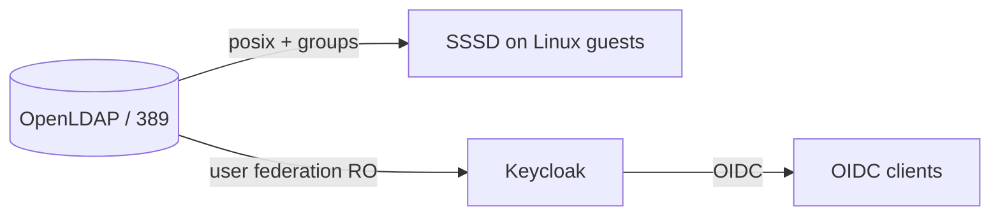

# Architecture

## Scaffold scope

Ansible roles for **Ubuntu 24.04** guests implement baseline **hardening**, optional **SSSD→LDAP**, and **k3s** (Cilium-oriented install). Argo `Application` manifests still pin chart versions as examples — validate before production. See **TODO (implement)** below.

## Control plane

- **Proxmox**: VM/LXC lifecycle and NIC attachment to `vmbr2` stay **manual** (Web UI or future separate automation).
- **Ansible**: baseline hardening (UFW/SSH/unattended upgrades), optional SSSD→LDAP, pinned k3s install (`ansible/`).
- **Argo CD**: GitOps for cluster platform + apps (`clusters/prod/`). **Fleet** is noted as an alternative in `clusters/prod/README.md`.
- **DNS**: Terraform scaffold under `dns/terraform/` (multi-provider; see `dns/README.md` and ADR 0005).
- **ADRs**: Decision log in `docs/adr/`.

## Identity flow

## TODO (implement)

- Hardening for non-Debian distros; WireGuard role if you want automated guest config (runbook keeps underlay manual today).
- Red Hat–family SSSD packages (`oddjob-mkhomedir`) if you add RHEL-based guests.
- Operator kubeconfig: fetch to `~/.kube/configs/pve-ffm.yaml` ([runbook](runbooks/kubeconfig.md)); never commit credentials.
- Platform apps via Argo CD only ([runbook](runbooks/argocd-bootstrap.md)); Cilium/Longhorn sync waves `-30`/`-20`.
- Workloads on workers only ([worker-scheduling.md](runbooks/worker-scheduling.md)); control-plane disk/Failed pods ([cluster-health.md](runbooks/cluster-health.md)).
- Homelab userspace: Kubero on k3s, not Dokploy ([homelab-apps.md](runbooks/homelab-apps.md)).
- Staging cluster (`clusters/staging/`) mirroring prod with smaller node counts.
- ApplicationSet for multi-env if you outgrow static `Application` files.
